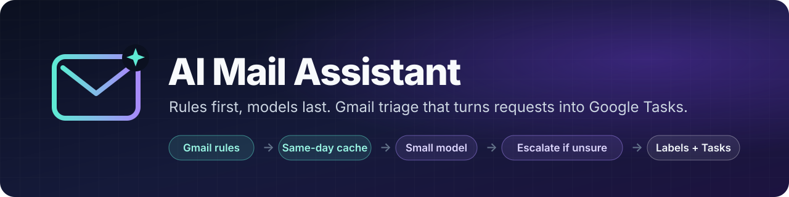
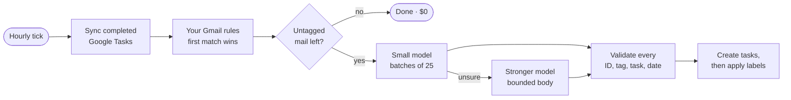

<p align="center">
  
</p>

<p align="center">
  <a href="https://github.com/mmornati/ai-email-assistant/actions/workflows/ci.yml"></a>
  <a href="LICENSE"></a>
  
  
  
</p>

<p align="center">
  <a href="https://mmornati.github.io/ai-email-assistant/"><b>Website, demo and film</b></a> ·
  <a href="#-quick-start">Quick start</a> ·
  <a href="docs/how-it-works.md">How it works</a> ·
  <a href="docs/configuration.md">Configuration</a> ·
  <a href="docs/scheduling.md">Scheduling</a> ·
  <a href="docs/costs.md">Costs</a> ·
  <a href="docs/README.md">All docs</a>
</p>

---

**AI Mail Assistant** keeps your Gmail inbox triaged every working hour. Your own
Gmail rules handle the routine mail; a small model looks only at the human mail
those rules cannot place, and a stronger model sees only what the small one is
unsure about. The classifier is the CLI you already use: the **GitHub Copilot
CLI** or **Claude Code**. Requests become Google Tasks with a due date and a link back to the
thread. When you complete a task, the thread is tidied up automatically.

If there is nothing new, **no model is called and nothing is spent**.

## ✨ Highlights

<table>
<tr>
<td width="33%" valign="top">

### 💸 Costs cents, not dollars
Rules and a same-day cache come first, then small-model batches, then
escalation for ambiguous mail only. Empty runs cost **$0** in model tokens.
[See the numbers →](docs/costs.md)

</td>
<td width="33%" valign="top">

### 🛡️ Safe by default
Every command is a **dry run** until you add `--apply`. Nothing is ever sent,
forwarded, unsubscribed or permanently deleted. Label changes and trash can be
undone from the journal.

</td>
<td width="33%" valign="top">

### ✅ Mail → Tasks
Requests become Google Tasks with due dates computed in code, deduplicated per
thread. Completing a task runs that tag's cleanup actions on the thread.

</td>
</tr>
<tr>
<td valign="top">

### 🔒 Least privilege
Only the `gmail.modify` and `tasks` OAuth scopes. Model calls run with no tools,
in a temporary directory, with mail passed on stdin. Local state is owner-only.

</td>
<td valign="top">

### 🧠 Learns your senders
The `mail-setup` skill reads a bounded sample **read-only** and proposes exact
sender rules. You approve each one, and every approved rule means fewer model
calls.

</td>
<td valign="top">

### ⏰ Runs on its own
A launchd job runs hourly, Monday to Friday, 08:00–19:00, with no AI session
in the loop. Status, logs and usage reports live in local files.

</td>
</tr>
</table>

## 🚀 Quick start

> **You need:** a Mac with [Homebrew](https://brew.sh), a Gmail account, and
> (for classification) a GitHub Copilot or Claude subscription.

```bash
git clone https://github.com/mmornati/ai-email-assistant.git
cd ai-email-assistant
make setup                 # or: bash scripts/setup-macos.sh --cli claude
```

That single command installs the CLIs and Python 3.10+ if needed, creates your
private `rules.json` and `state/`, signs you in to Google (Gmail + Tasks only)
and your classifier CLI, then runs the offline tests and a **read-only** preview. It is safe
to re-run at any time, and `make setup-preview` prints every command without
running any of them.

Then:

```bash
make doctor      # ✓ / ✗ health check of every dependency and login
make preview     # read-only, model-free dry run: what would the rules do?
make classify    # add paid classification, still a dry run
make apply       # apply labels and tasks, after a confirmation prompt
```

<details>
<summary><b>What does <code>make doctor</code> look like?</b></summary>

```text
==> AI Mail Assistant health check
  ✓ macOS
  ✓ Homebrew
  ✓ Python 3.10+ (/opt/homebrew/bin/python3.13)
  ✓ Google Workspace CLI (gws)
  ✓ Google Cloud CLI (first-time OAuth setup only)
  ✓ GitHub Copilot CLI (selected classifier CLI)
  ✓ rules.json
  ✓ state/ is private (0700)
  ✓ gws authorized for Gmail + Tasks
  ○ Hourly schedule installed (optional)  → make schedule-install, after reviewing a dry run

  ✓ ready: 'make preview' runs a read-only, model-free dry run
```

</details>

🎬 **No account yet?** `make demo` runs the real engine on an invented mailbox, and the
[demo console and film](https://mmornati.github.io/ai-email-assistant/) show the same run.

📖 **The full walkthrough**, including personalizing rules and a manual install, is in
[**Getting started**](docs/getting-started.md).

## 🔍 How it works



Mail the models still cannot place stays **untagged in your inbox** for you to
review. Nothing is guessed, archived or filed by default.
[Read the architecture →](docs/how-it-works.md)

## 🧰 Everyday commands

Run `make help` for the full list.

| Command | What it does | Changes mail? |
| --- | --- | :---: |
| `make doctor` | Check installs, logins, permissions and schedule | — |
| `make preview` | Rules and cache only: no model, no changes | — |
| `make classify` | Paid classification, dry run | — |
| `make review` | Preview the plan from the last dry run | — |
| `make apply` | Apply labels, tasks and actions (asks first) | ✏️ |
| `make summary` | Show the last run's `state/summary.json` | — |
| `make usage` | Model calls and tokens recorded so far | — |
| `make discover` | Read-only sender discovery for new rules | — |
| `make schedule-install` | Hourly weekday launchd job (runs with `--apply`) | ✏️ |
| `make schedule-uninstall` | Remove the schedule | — |
| `make test` | Offline test suite: no mailbox, no model | — |

## 🏷️ Tags out of the box

`Action` · `Alerts` · `GitHub-Admin` · `Meeting/Invite` · `Meeting/Notes` ·
`Shares` · `Admin` · `Internal-Comms` · `Newsletter` · `Promo` · `FYI` · `Backlog`

Each tag has a task policy (`always`, `optional` or `never`) and optional actions
such as archive, mark read or star. They appear in Gmail as `AI/<tag>`.
[Customize them →](docs/configuration.md)

## 💰 What it costs

| Scenario over 22 workdays | Estimated usage value |
| --- | ---: |
| Rules and cache resolve everything | **$0** |
| 2 small-model calls/day | $0.15/month |
| 12 small-model calls/day + 1 escalation/day | $2.46/month |

These are illustrative estimates at Copilot rates, not caps. `make usage` reports your real
numbers. [Full breakdown and rates →](docs/costs.md)

## 📚 Documentation

| | |
| --- | --- |
| 🚀 [Getting started](docs/getting-started.md) | Install, health check, first run, personalized rules |
| 🔍 [How it works](docs/how-it-works.md) | Pipeline, layout, model routing, safety model |
| ⚙️ [Configuration](docs/configuration.md) | `rules.json` and `classifier.json` reference |
| 🔀 [Classifier CLI](docs/classifier-cli.md) | Copilot or Claude Code: switching, isolation, auth |
| ⏰ [Scheduling](docs/scheduling.md) | launchd job, monitoring, exit codes |
| 🤖 [Interactive review](docs/interactive-review.md) | The `mail-triage` skill in Copilot or Claude Code |
| 💰 [Costs](docs/costs.md) | Rates, measured overhead, monthly estimates |
| 🛠️ [Operations](docs/operations.md) | Command reference, undo, troubleshooting |
| 📦 [Sharing a ZIP](docs/sharing.md) | Hand a clean copy to a colleague |

## 🗂️ Project layout

```text
├── runner.py · triage.py · mail_setup.py · schedule.py   CLI entry points
├── rules.example.json · classifier.json                  Configuration
├── Makefile                                              `make help`
├── scripts/setup-macos.sh                                Installer + doctor
├── tools/                                                Packaging and benchmark
├── .github/skills/ · .claude/skills/                     Copilot / Claude Code skills
├── docs/                                                 Guides and ADRs
└── tests/                                                Offline test suite
```

## 🤝 Contributing, security and license

Contributions are welcome; see [CONTRIBUTING.md](CONTRIBUTING.md). Please report
vulnerabilities privately as described in [SECURITY.md](SECURITY.md); never share
real mail or files from `state/` in issues.

Released under the [MIT License](LICENSE). This project is not affiliated with
Google or GitHub. You are responsible for complying with your organization's
policies on mailbox automation and AI processing of email.
