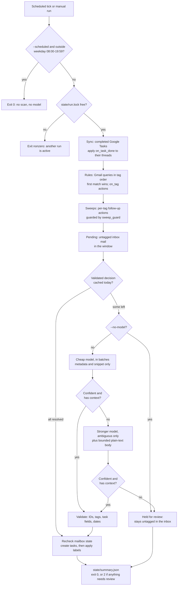

# How it works

`runner.py` is the entry point the schedule calls. It drives the deterministic
engine in `triage.py`, decides whether a model is needed at all, and writes a
summary. This page follows one run from start to finish.

Every mailbox write in this diagram happens only with `--apply`. Without it, each
station records what it would do in `state/plan.json` and nothing changes.

{ loading=lazy }
{ loading=lazy }

## The stations

### Lock

Before anything else, the run takes an exclusive lock on `state/run.lock`. A
second runner, `triage.py` or `mail_setup.py` process exits with an error instead
of touching shared state. The file can remain after a run; the operating system
releases the lock itself, including after a crash.

With `--scheduled`, a run that wakes outside weekdays 08:00-19:59 (for example a
catch-up after the Mac slept) exits immediately without scanning.

### Sync

The run reads your Google Tasks list. For each **completed** task that carries the
assistant's marker, it applies the tag's `on_task_done` actions (for example
`archive`) to the messages of that thread that are still in the inbox. See
[Tasks](tasks.md#completing-a-task).

### Rules

Each tag in `rules.json` has a list of Gmail search queries. The run evaluates
tags in file order. For each query it searches
`in:inbox <window> (<query>)`, excluding mail that already carries any `AI/*`
label. A message matched by an earlier tag is not considered for later ones:
first match wins. Matched mail gets the tag's label plus any `on_tag` actions,
and tags whose task policy is `always` get a task. See [Rules](rules.md).

### Sweep

Each tag can define sweeps: a Gmail condition plus actions, such as "archive and
mark read anything in this label older than one day". Sweeps search the inbox for
mail carrying the tag's label, so they also tidy mail tagged on earlier runs, not
only this run's. The `sweep_guard` query (by default `-is:starred`) is added to
every sweep, so starred mail is left alone.

### Pending

Inbox mail in the window that has no `AI/*` label and was not just tagged or
archived is written to `state/pending.json` with a fresh batch ID. For each
message it records the sender, recipients (To and Cc, truncated), date, subject, a
snippet of up to 240 characters, and whether a `List-Unsubscribe` header marks it
as bulk mail.

If nothing is pending, the run never starts a model.

### Cache

Each pending message is looked up in `state/classification-cache.json`. The cache
key covers the message's metadata, the current rules, the classifier settings and
**today's date**, so a cached decision is reused only on the same day with the same
configuration. A dry run followed by an applied run therefore pays for
classification once. Messages that were already escalated and still ambiguous
today are held for review rather than paid for again (use `--retry-review` to try
again deliberately).

### Cheap model

What is left goes to the cheap model (`gpt-6-luna` by default) in batches of up to
25 messages, at most 4 batches per run. The model sees the tag names, their
descriptions and task policies, and each message's metadata and snippet. It returns
for each message a tag, an optional task, a confidence between 0 and 1, and a
`needs_context` flag. Messages beyond the per-run capacity stay pending for the next
run.

### Escalation

A message is ambiguous if the cheap model set `needs_context` or reported
confidence below `confidence_threshold` (0.85). Up to `max_escalations` (10)
ambiguous messages per run go to the stronger model (`gpt-6.1-sol`), this time with
up to 4,000 characters of the message's plain-text body. Attachments and other
messages in the thread are not fetched. If the stronger model is still unsure
(below 0.9, or `needs_context`), the message is held for review.

### Validation

Every model response must contain exactly the requested message IDs, each with
exactly the fields `tag`, `task`, `confidence` and `needs_context`. Tags must exist
in your rules. Tasks are only allowed where the tag's policy permits them, titles
must be 1-250 characters, notes at most 2,000, due dates must be real
`YYYY-MM-DD` dates, and the model cannot set completion actions. Anything else
fails the whole batch and nothing from it is applied.

### Recheck

On an applied run, just before writing, the runner fetches each classified
message's current labels. If any message has left the inbox or gained an `AI/*`
label since it was scanned, the run stops with "mailbox changed since
classification; run again".

### Tasks, then labels

Tasks are created **before** labels are applied. If a task write fails, the message
is still untagged and is retried on the next run instead of being labeled without
its task. Then each message gets its tag's label and `on_tag` actions, and the
sweeps run once more so newly classified mail can be tidied in the same run.

Gmail and Google Tasks writes are not one atomic transaction. After a partial
failure, inspect the error and the journal.

### Summary

The run replaces `state/summary.json` with counts and status, and prints one line
of counts. It exits `0` when nothing needs review and `2` when some mail is held
for review or exceeded the per-run capacity. On an applied run, `state/pending.json`
is rewritten to contain only the unresolved messages.

If a run fails, the summary records `status: "error"` and the exception type, but
not the exception text, because external errors can contain mail content. Rule and
sweep changes already applied in that run are not rolled back.

## Where the model is not involved

Searching, rule tagging, sweeps, task-completion sync, task deduplication, default
due dates (+2 business days, computed in code), the plan, the journal and the
summary are all plain code. The model's only job is to suggest a tag and, where
allowed, a task for mail no rule recognized.
