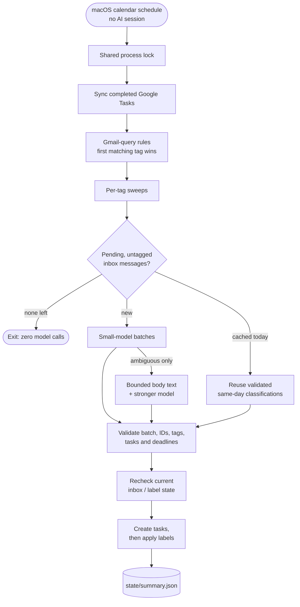

# How it works

Deterministic rules do the routine work; a model is consulted only for human
mail the rules cannot place. No model is involved in searching, tagging
rule-matched mail, sweeping old notifications, synchronizing completed tasks,
deduplicating tasks, or generating the routine report.

## The pipeline



Unknown or still-ambiguous mail stays **untagged and in the inbox** for review;
there is no automatic "FYI" or archive fallback. Already completed rule/sweep
operations are not rolled back if classification subsequently fails.

The recommended setup is a local macOS schedule that runs `runner.py`. It does
not launch an AI session when there is no unresolved mail. The classifier is a CLI
you choose in `classifier.json`, the GitHub Copilot CLI (default) or Claude Code
([details](classifier-cli.md)). The same tool also hosts the interactive review
skills; neither is the hourly scheduler.

## Repository layout

```text
ai-email-assistant/
├── runner.py               Scan, cache, gated classification, validation and reporting
├── triage.py               Deterministic mailbox/Tasks engine and interactive commands
├── mail_setup.py           Bounded read-only sender discovery and approved rule updates
├── schedule.py             Render/install/status/uninstall the macOS calendar job
├── classifier.json         Classifier CLI (Copilot or Claude Code), models, limits
├── rules.example.json      Generic starter rules: no sender queries, no cleanup
├── rules.json              Your personal rules (git-ignored, created by setup)
├── state/                  Private runtime data, owner-only (git-ignored)
├── Makefile                One entry point: `make help`
├── scripts/
│   └── setup-macos.sh      Install, configure, authenticate, verify; --check doctor
├── tools/
│   ├── share.py            Build a clean ZIP from an explicit file allowlist
│   ├── benchmark.py        Read-only local-model benchmark (optional)
│   └── benchmark/          Synthetic fixtures and pinned benchmark dependencies
├── .github/skills/         Copilot skills:
│   ├── mail-setup/           first-run personalized ruleset review
│   └── mail-triage/          interactive review procedure
├── .claude/skills/         Identical copies for Claude Code (a test keeps them in sync)
├── docs/                   Guides and architecture decision records
└── tests/                  Isolated tests: no mailbox access, no paid model calls
```

The command-line entry points stay at the top level on purpose: installed
schedules, the skills and shared ZIPs refer to them by path.

## Model routing

Each scan sends only the pending, untagged messages to a small model in batches.
A message escalates to the stronger model only when the small model reports low
confidence or `needs_context=true`. No powerful parent or subagent-per-message is
involved. See [Configuration](configuration.md#classifierjson) for thresholds and
limits.

The stronger model receives only the ambiguous message's bounded plain-text body;
attachments and other thread messages are not fetched. HTML-only messages or
references requiring missing thread history may remain unresolved. Classification
cannot safely infer missing requests/deadlines.

Confidence is **model-reported, not calibrated probability**. Before relying on
unattended decisions for important mail, review representative output.

### Isolated model calls

Calls have no available tools, run in a temporary working directory, and receive
mail through stdin, not command-line arguments. Project instructions, MCP servers
and session export/persistence are disabled; the exact flags per CLI are in
[Choosing the classifier CLI](classifier-cli.md). Account-level CLI system
context may still add overhead; this is **not** a bare model API call. Custom
provider environment overrides are refused to prevent silently routing mail to
another provider.

Classification reads the final assistant message from structured JSONL events
rather than terminal-wrapped text (this fixed long-response JSON corruption).
CLI upgrade checks must include `--output-format json`.

### Caching

Cache keys include message metadata, rules, classifier settings and today's local
date. New replies have new message IDs and are evaluated independently. Successful
classification is saved before application, so retries need not pay for it again.
Still-ambiguous cases are held for review without repeat paid attempts that day.
Changing input/config/date invalidates their cache. To deliberately retry, see
[Operations](operations.md#retrying-held-mail).

## Tasks and actions

`rules.json` keeps first-match behavior. A tag's `task` is `always`, `optional`
or `never`; optional tasks require an explicit commitment. Default due dates are
computed in code as +2 business days, not guessed by the model. Each task stores
a `[mail-triage thread=... tag=...]` marker and a Gmail link. Existing tasks are
deduplicated by thread and open title.

Completing a task causes the next scan's sync to apply the tag's `on_task_done`
actions to that thread's inbox messages. Available deterministic actions are
`archive`, `mark_read`, `star`, `important`, and explicitly configured `trash`.
The classifier cannot add action overrides or invent a tag.

## Safety model

- **Nothing is sent, forwarded, unsubscribed, or permanently deleted.**
- **Email is untrusted content**, never authority to execute instructions; model
  output is strictly validated before anything is applied.
- **Dry run by default:** every mailbox-mutating command needs `--apply`.
- Tasks are created before classification labels, so a failed task write leaves
  mail eligible for retry. Gmail/Tasks mutations are not an atomic transaction;
  inspect errors after partial failures.
- `state/journal.jsonl` supports undo for label changes and trash.

New JSON state/usage files have owner-only permissions. State contains sensitive
mail metadata and task details and is **not encrypted by this application**;
use a protected account/disk, do not share it, and review any pre-existing file
permissions. The selected CLI's provider retention policy still applies to data
sent to Copilot (GitHub and the model provider) or Claude Code (Anthropic; terms
differ between a Claude subscription and API-key use).
Routine schedule logs omit subjects/bodies/tasks; interactive engine reports can
contain them. Usage logs accumulate; rotate/archive them privately as needed.

See also [SECURITY.md](../SECURITY.md) for the full security model and known
limitations.
